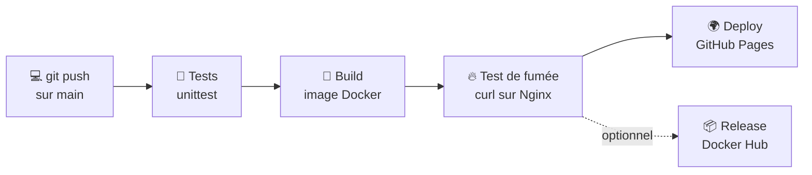

<div align="center">

# 🚀 Portfolio DevOps

### Du portfolio au déploiement continu

**Git · Docker · Nginx · Docker Compose · GitHub Actions**

[](https://github.com/Ramadiaw12/portfolio-devops/actions)


**[🌐 Voir le site en ligne](https://ramadiaw12.github.io/portfolio-devops/)**

</div>

---

## 📖 À propos

Ce dépôt est le livrable de l'**Atelier DevOps**. L'objectif : prendre un site portfolio statique (HTML, CSS, JavaScript) et lui appliquer toute la chaîne DevOps, **de `git push` jusqu'à la mise en ligne**, sans aucune intervention manuelle.

Chaque modification poussée sur `main` déclenche automatiquement :

1. la **vérification** de la structure du site (tests automatisés),
2. la **construction** d'une image Docker et un test de fumée du conteneur,
3. le **déploiement** sur GitHub Pages,
4. *(optionnel)* la **publication** de l'image sur Docker Hub.

> Le site lui-même est le portfolio de **Ramatoulaye Diawane**, AI Infrastructure Engineer.

---

## 🧭 Pipeline CI/CD



| Étape | Job | Ce qui est vérifié |
|-------|-----|--------------------|
| 1 | `test` | Fichiers indispensables, balise `<title>`, feuille de style liée, sections obligatoires, un seul `<h1>`, Dockerfile basé sur Nginx |
| 2 | `build` | L'image Docker se construit et le conteneur répond avec la page d'accueil (`id="contact"` présent) |
| 3 | `release` | Publication sur Docker Hub, activée uniquement si la variable `DOCKERHUB_ENABLED` vaut `true` |
| 4 | `deploy` | Publication des fichiers statiques sur GitHub Pages |

Chaque job dépend du précédent (`needs`) : **si un test échoue, rien n'est déployé.**

---

## 🗂️ Structure du projet

```
portfolio-devops/
├── .github/workflows/   # Pipeline GitHub Actions (CI/CD)
├── assets/              # CV (PDF) et ressources téléchargeables
├── css/                 # Feuilles de style
├── images/              # Photo de profil, certifications, favicon
├── interface/           # Captures d'écran des projets
├── js/                  # carousel.js · contact.js · main.js
├── tests/               # Tests automatisés (unittest)
├── Dockerfile           # Image Nginx servant le site
├── docker-compose.yml   # Lancement local en une commande
└── index.html           # Page unique du portfolio
```

---

## 🛠️ Stack technique

| Domaine | Outils |
|---------|--------|
| Site web | HTML5, CSS3, JavaScript (vanilla) |
| Versionnement | Git, GitHub, branches de fonctionnalité (`feature/contact`) |
| Conteneurisation | Docker, Nginx (image légère) |
| Orchestration locale | Docker Compose |
| Intégration et déploiement continus | GitHub Actions, GitHub Pages |
| Tests | Python 3.12, `unittest` |

---

## ⚡ Démarrage rapide

### Prérequis

- [Git](https://git-scm.com/)
- [Docker](https://docs.docker.com/get-docker/) et Docker Compose
- Python 3.12 (uniquement pour lancer les tests)

### 1. Cloner le dépôt

```bash
git clone https://github.com/Ramadiaw12/portfolio-devops.git
cd portfolio-devops
```

### 2. Lancer avec Docker Compose

```bash
docker compose up -d --build
```

Le site est accessible sur **http://localhost:8080** (adapter le port selon ton `docker-compose.yml`).

Pour l'arrêter :

```bash
docker compose down
```

### 3. Ou avec Docker seul

```bash
docker build -t portfolio-devops .
docker run -d --name portfolio -p 8080:80 portfolio-devops
```

### 4. Ou sans Docker (aperçu rapide)

```bash
python3 -m http.server 8000
```

Puis ouvre **http://localhost:8000**.

---

## 🧪 Lancer les tests

```bash
python3 -m unittest discover -s tests -v
```

Les tests vérifient notamment que :

- les fichiers indispensables existent,
- la page a un `<title>` et lie sa feuille de style,
- les sections obligatoires sont présentes (`accueil`, `apropos`, `competences`, `projects`, `contact`),
- la page ne contient **qu'un seul `<h1>`** (bonne pratique d'accessibilité et de SEO),
- le `Dockerfile` s'appuie bien sur Nginx.

---

## 🔄 Workflow Git

```
main ──●────────●────────●──────────▶   production (déployée automatiquement)
        \      /          \
         ●────●            ●───●
     feature/contact     fix/...
```

- `main` est la branche de production : chaque push la déploie.
- Les nouvelles fonctionnalités se développent sur des branches `feature/...`, puis sont fusionnées via **Pull Request**. La pipeline de tests s'exécute aussi sur les Pull Requests.

---

## 🎓 Retours d'expérience

Quelques pièges rencontrés pendant l'atelier, utiles à garder en tête :

| Problème rencontré | Cause | Solution |
|--------------------|-------|----------|
| Images, JavaScript et CV absents du site en ligne | L'étape `Préparer le site` du workflow ne copiait que `index.html` et `css` | Copier aussi `js`, `images`, `interface` et `assets` dans `_site/` |
| Boutons de la navbar sans effet | Les liens (`#home`, `#skills`...) ne correspondaient pas aux `id` des sections (`accueil`, `competences`...) | Aligner liens et `id` |
| Section Projets sans style | `id="projets"` dans le HTML, mais `#projects` dans le CSS | Un seul nom partout |
| Déploiement bloqué | Le test « un seul `<h1>` » échouait, donc `build` et `deploy` ne partaient pas | Les titres de section passent en `<h2>`, seul le nom reste en `<h1>` |

**À retenir :** un site qui fonctionne en local peut être incomplet en production si la pipeline ne publie pas les bons fichiers. Tester le rendu en ligne après chaque changement de workflow évite ce piège.

---

## 🚧 Pistes d'amélioration

- [ ] Ajouter un test qui vérifie que chaque dossier référencé dans le HTML est bien copié dans `_site/`
- [ ] Vérifier que chaque lien `href="#..."` pointe vers un `id` existant
- [ ] Ajouter un contrôle de liens cassés et d'images manquantes
- [ ] Mettre en place Lighthouse CI (performance, accessibilité, SEO)
- [ ] Publier l'image sur un registre avec versionnement par tag (`v1.0.0`)
- [ ] Ajouter un environnement de prévisualisation pour les Pull Requests

---

## 👩‍💻 Auteure

**Ramatoulaye Diawane** : AI Infrastructure Engineer

[](https://github.com/Ramadiaw12)
[](https://www.linkedin.com/in/ramatoulaye-diawane-bb87b01b4)

---

<div align="center">

*Projet réalisé dans le cadre de l'Atelier DevOps · 2026*

</div>